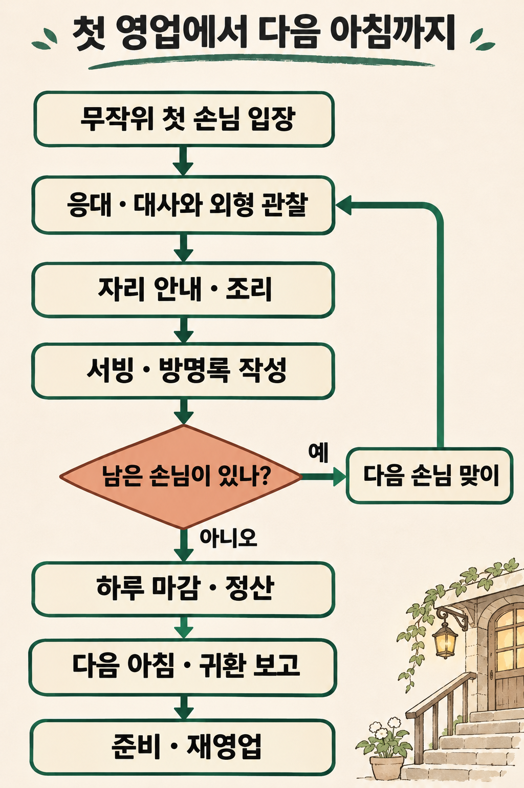

# 4-2. 하루 영업 순서

[← 4장 목차](README.md) · [메인 기획서](../메인기획서.md)

## 첫 본영업은 이렇게 흘러간다

게임은 0일차 연습으로 시작한다. 1일차 본영업에는 전날 손님이 없으므로 **귀환 보고 없이 영업 준비부터** 시작한다.

```text
[1일차] 영업 준비(시장) → 영업 시작 → 응대·추리 → 자리 → 요리 → 서빙 → 식후 반응 → 방명록 작성·퇴장
        → (그날 손님을 모두 처리) → 영업 종료·당일 정산 → 자동 저장
[2일차] 다음 일차 시작 → 아침 귀환 보고 → 준비 → 영업 …
```

| 구간 | 시간 제한 | 하는 일 |
| --- | --- | --- |
| 아침 귀환 보고 | 없음 | **2일차부터.** 전날 던전에 내려간 손님이 한 명씩 돌아와 결과를 보고한다. 전리품·새 레시피·수첩 기록·호감 변화가 나온다 → [4-7](07-귀환보고와재방문.md) |
| 영업 준비 | 없음 | 오늘의 소식(이변), 💡 입소문으로 정해진 오늘 손님 수와 그 이유, 시장에서 양념·던전 재료 구매, 레시피·수첩 확인, 가게 개량. 1일차는 여기서 시작한다 |
| 영업 | 💡 없음 | 손님이 무작위 간격으로 들어온다. 응대·자리·요리·서빙을 처리한다 → [4-1](01-손님응대와처방.md) |
| 영업 종료·당일 정산 | — | 오늘 올 손님의 모든 방문이 끝나면 정산을 한 번 연다. 매출·지출·금고와 지금 던전에 있는 손님을 확인한다 |
| 자동 저장 | — | 정산 효과를 한 번 적용하고 일차를 넘긴 뒤, 다음 날 시작 시점을 자동 저장한다 |

## 영업 규칙

- **💡 영업 시간 없음** (2026-11-24 송예찬 결정, 팀 합의 전) — 예전의 영업 약 180초와 하루 6명 고정을 없앴다. 그날 손님을 모두 처리하면 마감한다.
- **동시 좌석과 하루 손님 수는 따로 센다.** 💡 시작 3석·화구 2개로 검증한다.
- **하루 손님 수** = 성장 단계별 기본 인원(1일차 본영업 3명) + 전날 방문 호감 합에 따른 입소문 추가(0~4명) − 부상 휴식·재방문 거절 결석. 계산과 예시는 [4-8 호감과 입소문](08-호감과입소문.md)에 있다. 성장 단계별 기본 인원은 🔴 미정이다.
- **입장 간격은 무작위다** (2026-11-24 송예찬, 이슈 #30). 빠르고 정확하게 응대·추리할 이유를 만들기 위해서다. 최소·최대 간격, 입구 줄 인원, 입장 순서는 🔴 미정이다.
- **시간은 손님이 기다리는 동안에만 흐른다.** 오래 기다린 손님은 떠난다([4-1](01-손님응대와처방.md#손님을-받지-못하고-끝나는-경우)).

## 마감 조건

💡 「오늘 올 손님의 모든 방문이 끝난 상태」에서 마감한다. 방문이 끝나는 방법은 세 가지다.

| 방문이 끝나는 방법 | 예 |
| --- | --- |
| 방명록 작성 완료 | 서빙한 손님이 방명록을 다 쓰고 계단으로 내려감 |
| 돌려보냄 | 마지막 손님을 돌려보내 방명록이 없음 → 그 순간 모든 방문이 끝났으므로 정산이 열림 |
| 기다리다 떠남 | 마지막 손님이 30초를 넘겨 떠남 |

마지막 손님에게 서빙한 직후에는 아직 마감하지 않는다. 그 손님의 방명록이 완성되어야 정산이 열린다. 상태 전이는 김언호가 확인한다.

## 데모 엔딩과의 관계

데모에서는 그날 **실제로 서빙을 마친 서로 다른 손님이 12명 이상**이면, 그날의 모든 방문이 끝나고 정산창을 확인한 뒤 엔딩으로 간다. 11명 이하면 다음 일차로 넘어간다. 사례와 엔딩 후 이어하기는 [4-9 성장과 데모 엔딩](09-성장과데모엔딩.md)에 있다.

## 저장

저장은 **일차 시작 스냅샷** 기준이다(2026-11-23 확정).

- 일일 정산이 끝나면 효과를 한 번만 적용하고 일차를 넘긴 뒤 다음 날 시작 시점을 자동 저장한다.
- 수동 저장은 언제든 할 수 있고, 현재 일차의 시작 시점을 별도 수동 슬롯에 저장한다.
- 불러오기와 타이틀의 이어하기는 저장된 일차의 시작부터 다시 시작하고, 그날의 진행은 버린다. ESC 메뉴의 이어하기는 현재 화면으로 돌아간다.
- 💡 다음 날 저장에 아직 처리하지 않은 아침 보고를 담아 보상·호감을 한 번만 적용하는 방식은 제안 단계다([현재 결정과 검토 사항](../08-결정필요사항/현재결정과검토사항.md#저장과-게임-진입)).

세부 문구와 ESC 메뉴는 [제작 순서와 저장 기준](../09-승인과제작기준/02-제작순서와저장기준.md)에 있다.

## 제작 순서와 게임 순서는 다르다

| 구분 | 순서 |
| --- | --- |
| 플레이어가 겪는 순서 | 타이틀 → 새로 시작 → 0일차 연습 → 1일차 본영업 → 마감·정산 → 2일차 아침 귀환 보고 → 준비 → 재영업 |
| 만드는 순서 | 1일차 본영업 루프 → 데모 엔딩 → 0일차 튜토리얼 → 남은 시간에 스토리 ([FeatureManagerMap 제작 우선순위](../../개발/FeatureManagerMap.md)) |
| 구현 (f7f286c 코드 기준, 실행 검증 아님) | 1일차 명단(기본 3명 + 입소문 추가)으로 손님을 무작위 간격에 입장시키고 30초 대기 이탈을 처리한다. 마감 정산에서 방문 호감과 다음 영업 추가 인원을 계산하며, 입맛 점수는 임시로 0이다. 다음 아침 귀환 보고에서 전리품을 확정한다 → [4-8 기획과 구현](08-호감과입소문.md#기획과-구현) |

후속 스토리 단계에서는 날짜 제한 없이 이야기를 첫 결과·단서·준비 조건으로 진행하고, 서사 장면은 귀환 보고와 정산을 끝낸 안전한 시점에 재생한다([4-10 후속 스토리 조건](10-후속스토리조건.md)).

## 흐름도



이전의 하루 흐름(아침 보고로 시작, 기본 3명 + 입소문 점수 ÷ 2, 첫날 튜토리얼 3명 고정)은 [결정 변경 이력](../08-결정필요사항/결정변경이력.md)에 있다.
