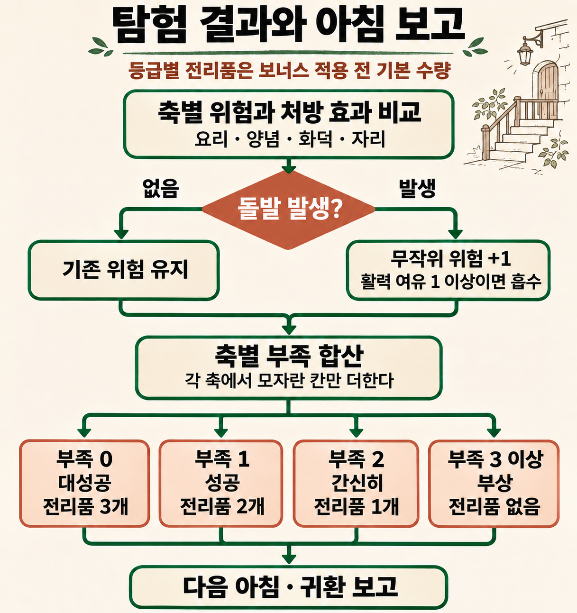

# 4-3. 던전 위험 판정

[← 4장 목차](README.md) · [메인 기획서](../메인기획서.md)

| 구분 | 규칙 |
| --- | --- |
| 플레이어 규칙 | 손님이 마주칠 위험을 알아내고, 같은 종류의 효과를 같은 만큼 내면 막아낸다. |
| 시스템 규칙 | ① 층 기본 위험·이변·종족·컨디션·개인 취약점을 합산한다. ② 직업 보정을 적용하고 축별 위험을 0 이상으로 맞춘다. ③ 요리·양념·화덕·자리 효과를 합친다. ④ 돌발 발생 여부·축과 활력 여유 보험의 흡수를 처리한다 — **스토리 이후 안건으로 보류**(2026-11-25. 판정 시점과 결과 저장 단위 미정). ⑤ **최종 부족 = Σ max(0, 최종 위험 − 처방 효과)** 로 결과 등급을 정한다. 다른 축의 남는 효과로 부족을 메우지 않는다. 입력·결과는 저장하고 다음 아침에 한 번 정산한다. 기본 위험·부족 계산과 부상(부족 3 이상)은 본영업에서 그대로 쓴다. |

## 위험과 효과의 짝

| 위험 | 막는 효과 | 손님이 돌려 말하는 표현 (예) |
| --- | --- | --- |
| 독 | 해독 | 슬라임 점액 · 독 안개 · 따끔함 |
| 열 | 내열 | 뜨거운 바닥 · 불길 · 타는 목 |
| 냉기 | 방한 | 언 손가락 · 서리 · 오한 |
| 어둠 | 야광 | 꺼진 횃불 · 보이지 않음 |
| 체력 | 활력 | 지침 · 허기 · 먼 길 |
| 함정 | 감각 | 발밑 · 울리는 바닥 · 눈치 |

## 위험은 어떻게 정해지나

각 축은 0에서 시작한다. 층 기본 위험은 1~3칸이다.

| 더하거나 빼는 것 | 값 | 비고 |
| --- | --- | --- |
| 층 기본 위험 | 목적지 층에 정해진 값 | [던전 층과 재료](../03-세계관과스토리/03-던전층과재료.md) |
| 오늘의 이변 | 열린 층 하나의 위험 하나 +1 | 💡 60% 확률(시험값). 아침 「오늘의 소식」으로 알린다. 첫 적용일은 아래 참고 |
| 컨디션 | 피곤해 보이는 손님 체력 +1 | 💡 30% 확률(시험값). 첫 적용일은 아래 참고 |
| 종족 약점 | 종족마다 한 축 +1 | 인간은 없음 → [직업과 종족](../05-데이터/직업과종족.md) |
| 개인 취약점 | 독·열·냉기·어둠·함정 중 한 축 +1 | 생성 시 30%(시험값). guestId에 고정하며 종족 약점과 같은 축이면 합산한다 |
| 직업 특성 | 직업마다 한 축 −1 | 마지막에 적용 → [직업과 종족](../05-데이터/직업과종족.md) |

**첫 적용일은 아직 정하지 않았다.** 원문은 이변·피로를 「2일차부터」, 개인 취약점을 「첫날 안내 손님 3명 제외, 둘째 날 첫 소개」로 적었다. 이 날짜는 0일차 연습이 생기기 전 시험 기준이며, 1일차 본영업에 처음 적용하는 날은 [FeatureManagerMap F3](../../개발/FeatureManagerMap.md#영업-시작부터-서빙까지)에서 다시 검토한다.

## 처방 효과

| 더하는 것 | 값 |
| --- | --- |
| 요리 | 레시피마다 정해진 효과 → [양념과 레시피](../05-데이터/양념과레시피.md) |
| 양념 | 하나당 해당 효과 +1. 처음에는 요리 하나에 한 칸, 양념 선반 개량으로 두 칸 |
| 화덕 개량 | 요리의 가장 강한 효과 +1 (2단계는 그다음 효과도 +1) |
| 자리 | 그 자리가 주는 효과 +1 → [4-5](05-자리안내와효과.md) |

## 결과 등급

| 최종 부족 | 등급 | 호감 표 이름 | 구안 기본 전리품 (정정 전·현재 구현) | 이후 |
| --- | --- | --- | --- | --- |
| 0 | 대성공 | 대성공 | 3개 | — |
| 1 | 성공 | 성공 | 2개 | — |
| 2 | 간신히 | 실패 | 1개 | 겨우 살아 돌아온다 |
| 3 이상 | 부상 | 대실패 | 없음 | 이틀 쉰다 |

- **돌발** — 탐험 중 25% 확률로 무작위 위험 하나가 +1 늘어난다. 단, 활력이 체력 위험보다 1 이상 남아 있으면 「든든히 먹은 덕에」 버틴다. 넉넉한 활력이 보험이 된다. 아침 「오늘의 소식」의 이변과는 다른 규칙이다. 판정 시점과 결과 저장 단위는 **스토리 이후 안건**이다. 첫 본영업 루프 검수에서는 돌발을 선행 조건으로 요구하지 않는다(2026-11-25). 오늘의 이변은 보류 대상이 아니다.
- **성공 이상**(대성공·성공)만 층 개방과 단골 레벨 경험치에 센다.
- **예외는 아무 일도 일어나지 않는 쪽으로 정한다.** 돌려보낸 손님은 던전에 가지 않으므로 판정도 없다.
- **전리품·선물** — 누적 개인 호감 9 이상인 손님부터 다녀온 던전 층의 희귀 재료를 가져올 수 있다. 누적 8이면 아직 아니고 정확히 9부터다(2026-11-25 사용자 정정). 위 표의 호감 무관 등급별 일반 재료 3 / 2 / 1 / 0개와 💡 대성공 30% 희귀 재료 1개는 정정 전 구안·현재 구현이며 현행 기준이 아니다. 구 시험 수치의 적용 여부는 이번 결정에 포함되지 않는다. 맛 점수 3 이상의 전리품 보너스([4-6](06-주방과서빙.md#맛과-금화))와 💡 호감 15 재료 약속·36 전리품 +1([4-8](08-호감과입소문.md#누적-호감이-열어-주는-것))은 기존 지위를 유지하며 9 자격을 대신하지 않는다.

### 예 · 1층 슬라임 숲으로 가는 수인 사제

1층 기본 위험은 독 1 · 체력 1이다. 수인의 예민한 코가 독 +1, 사제의 가호가 독 −1이므로 출발 전 실제 독은 1이다. 해독 1을 주면 독 부족은 0, 해독을 주지 않으면 1이다. 체력 1은 따로 계산한다. 수첩에서 단서를 얼마나 찾았는지는 이 판정을 바꾸지 않는다.

## 플레이어는 결과를 어떻게 아는가

| 시스템 규칙 | 화면·연출 |
| --- | --- |
| 위험 여섯 축 | 축마다 고정 색. 위험 칩(독·열…)과 효과 칩(해독·내열…)이 같은 색을 쓴다 |
| 효과의 크기 | 칩 옆의 칸(■) 개수 |
| 위험의 크기 | 수첩에 기록된 만큼만 보인다. 모르는 위험은 점선 빈 줄(기획 문서 표기 `?`) |
| 오늘 처방이 맞았는가 | 서빙 직후 각오 한마디, 다음 날 귀환 보고의 축별 결과. 첫 완성본은 각오 대사의 무작위 오차를 뺀다. 미확인 정보·돌발·실제 부족 원인을 보고에서 구분한다 |
| 층의 진짜 위험 | 귀환 보고 뒤 수첩에 기록된다 (한 번에 최대 두 축, 모자랐던 축 먼저) |

원본 그림 3(위험과 처방 효과 계산 예시)은 [구글 메인기획서](https://docs.google.com/document/d/1nFDNT7zw3tflOq4N4xJNqzioT0eQcbbVXVVCzUswXOE)의 기존 참고도다. 최종 결과는 이 문서의 순서를 따른다. 지금 본영업에서는 ①②③⑤로 부족 합을 계산한다. 「돌발·활력 여유 보험을 먼저 처리한 뒤 부족 합 계산」은 돌발 안건이 정해진 뒤의 차후 기획이다(스토리 이후, 2026-11-25).

> 흐름도 03의 등급별 기본 전리품은 2026-11-25 전리품 정정 이전 그림이다. 전리품·선물 자격은 위 본문이 우선한다.

## 기획과 구현

- **기획**: 위 다섯 단계 순서로 등급을 정하고, 결과는 다음 아침 보고에서 한 번 알린다.
- **구현 (f7f286c 코드 기준, 실행 검증 아님)**: 서빙 때 축별 부족 합으로 등급을 정하고 방문 결과에 전리품을 한 번 뽑아 둔다([ExpeditionJudge.cs](../../../Assets/_DOB/02.Scripts/System/ExpeditionJudge.cs) · [VisitResultLog.cs](../../../Assets/_DOB/02.Scripts/System/VisitResultLog.cs)). 자리 효과와 돌발·활력 보험은 아직 넣지 않았다(돌발은 스토리 이후 안건으로 보류). 💡 희귀 재료는 대성공일 때 기본 전리품에 1개를 더하는 시험 구현이다([ExpeditionRewards.cs:4–5](../../../Assets/_DOB/02.Scripts/Define/ExpeditionRewards.cs)). 등급별 일반 재료 지급과 이 희귀 재료 시험 구현에는 호감 9 조건이 없어 2026-11-25 사용자 정정과 다르므로 맞출 대상이다.
