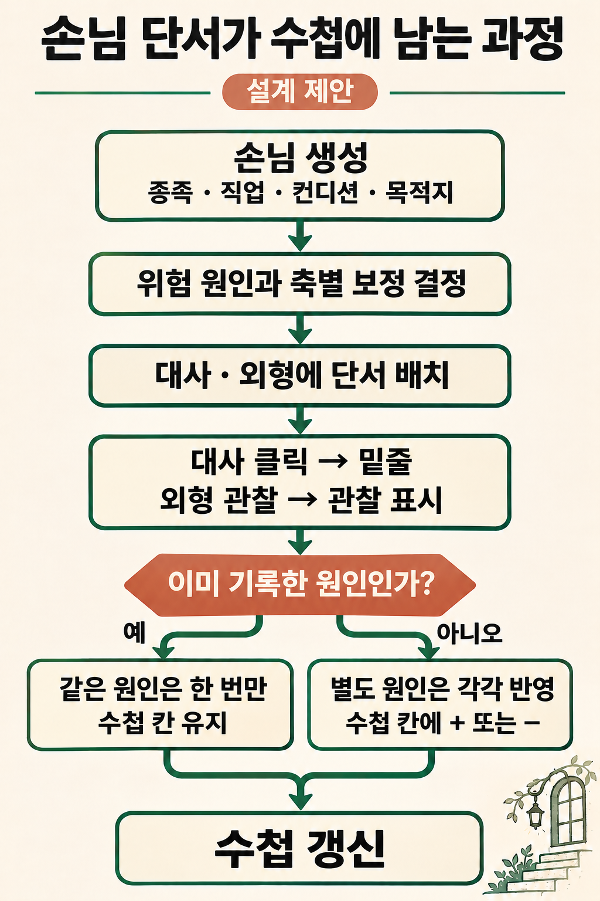

# 4-4. 단서 추리와 수첩

[← 4장 목차](README.md) · [메인 기획서](../메인기획서.md)

추리는 여섯 축 가운데 **오늘 이 손님에게 해당하는 축과 그 크기**를 찾는 일이다. 손님의 말과 차림은 같은 방문의 실제 위험 원인에서 나온다. 플레이어가 단서를 몇 개 찾았는지는 실제 위험을 바꾸지 않는다.

## 단서는 어디서 보이나

| 단서 | 보이는 곳 | 예시 |
| --- | --- | --- |
| 목적지 층 | 주문 대화 | 「3층 · 용암 균열」 |
| 대사 | 주문 대화. 위험을 돌려 말한 표현을 누르면 밑줄이 생기고 수첩에 기록된다 | 「그쪽은 숨만 쉬어도 목이 타.」 → 열 |
| 종족 | 외형(귀·키·꼬리), 수첩 사전 | 수인: 코가 예민하다 → 독 +1 |
| 직업 특성 | 장비(3D 외형), 수첩 사전 | 마법사: 불에 익숙하다 → 열 −1 |
| 컨디션 | 몸짓·땀방울 | 「피곤해 보인다」 → 체력 +1 |
| 개인 취약점 | 초상의 그림 레이어 | 기침·창백한 얼굴 → 독 +1 |
| 오늘의 소식 | 준비 화면 게시판 | 「바닥 틈의 열기가 오늘따라 거세다고 한다」 → 3층 열 +1 |
| 수첩 · 던전 | 수첩 탭 | 3층: 열 ■■■, ? 아직 모르는 위험 2개 |

## 대사 규칙

- 손님은 위험 축의 이름을 직접 말하지 않는다. 「독이 무서워」 대신 「슬라임 점액이 튀기만 해도 따끔하더라고」처럼 돌려 말한다.
- 대사는 그 손님의 **가장 큰 양수 축**을 가리킨다. 동률이면 방문을 만들 때 한 축을 추첨해 둔다.
- 여섯 축이 모두 0인 손님은 「별일 없을 거야」라고 말하고, 누를 수 있는 위험 표현을 붙이지 않는다.
- 💡 호감 21 이상인 단골은 단서를 두 개 말해 준다. 다른 양수 축의 원인을 먼저 고르고, 없으면 같은 축의 다른 원인을, 원인이 하나뿐이면 한 개만 말한다.
- 같은 방문에서 대화를 다시 열어도 같은 문장과 발견 기록이 나온다. 재방문하면 새 목적지·컨디션에 맞춰 문장을 다시 고른다.
- 수첩의 사전 탭에서 어떤 표현이 어느 축을 가리키는지 확인할 수 있다.

대사를 고르는 순서와 37개 원인 표는 [방문 대사 생성](방문대사생성.md), 실제 원고는 [손님 대사와 단서 원고](손님대사와단서원고.md), 원인별 데이터는 [대사와 관찰 단서표](../05-데이터/대사와관찰단서표.csv)에 있다.

## 수첩 칸은 원인별로 한 번 센다

**확정** ([FeatureManagerMap F11](../../개발/FeatureManagerMap.md#탐험-결과와-장기-기록)) — 발견한 표현은 모두 밑줄을 긋고, 수첩 칸은 **위험 원인별로 한 번** 센다.

| 규칙 | 결과 |
| --- | --- |
| 같은 원인을 가리키는 다른 표현을 찾음 | 밑줄은 늘지만 칸은 그대로 |
| 같은 표현을 다시 누름 | 기존 기록을 보여 주고 칸은 그대로 |
| 다른 원인을 찾음 (종족 약점·직업 보호 등) | 그 원인의 값만큼 더하거나 뺀다 |
| 그 축에서 아직 아무 원인도 찾지 않음 | 화면은 점선 빈 줄, 데이터는 값 없음(null). 이 문서의 표에서는 `?`로 적는다 |
| 찾은 원인의 합이 0 이하 | 축 이름과 빈 칸, 확인한 보정을 함께 표시. 0칸이어도 못 찾은 위험이 남아 있을 수 있다 |

### 예 · 1층 슬라임 숲으로 가는 수인 사제의 독

층의 점액 +1, 수인의 코 +1, 사제의 가호 −1 → 출발 전 실제 독은 **1**이다.

| 이번 방문에서 한 행동 | 화면에 남는 표시 | 독 칸 |
| --- | --- | ---: |
| 아직 찾지 않음 | 평문 대사, 독 줄은 점선 빈 줄 | ? |
| 「슬라임 점액」을 누름 | 그 말에 밑줄 | 1 |
| 같은 문장의 「따끔」을 누름 | 두 말에 밑줄. 둘 다 같은 층의 점액 | 1 |
| 코를 감싸는 몸짓을 관찰 | 수인 약점 관찰 표시 | 2 |
| 목에 건 성표를 관찰 | 사제 가호 관찰 표시 | 1 |

순서를 바꿔 성표 → 점액 → 코 순으로 찾으면 ?(점선 빈 줄) → 0칸(가호 −1 기억) → 0칸 → 1칸이다. 아직 못 찾은 상태(?)와 찾았지만 합이 0인 상태(0칸)는 다르게 보인다. 같은 원인을 모두 찾으면 어떤 순서든 같은 값에 닿는다. 해독 1을 주면 단서를 전부 찾았든 일부만 찾았든 독 부족은 0이다.

## 응대가 끝난 뒤

던전의 실제 위험 수치는 다음 아침 귀환 보고에서 확인한다. 보고 뒤에는 그 층의 아직 모르던 위험이 최대 두 축까지 수첩에 기록된다([4-7](07-귀환보고와재방문.md)). 새 방문의 발견 표시와 지난 방문에서 쌓인 사전 기록은 따로 관리한다.

## 기획과 구현

- **기획**: 위 규칙. 새 방문의 발견 표시와 지난 방문의 사전 기록은 따로 관리한다.
- **구현 (FeatureManagerMap의 14fd7e9 시점 대조, 이후 커밋은 다시 확인 필요)**: 손님 정보에서 실제 위험과 보여 줄 단서를 먼저 정하고, 대사·초상·수첩·주방이 같은 방문을 쓴다. 37개 원인 데이터가 있고 생성 방문은 원인별 칸 방식으로 작동한다. 본영업의 장기 기록 연결은 그 시점에 남아 있었다([FeatureManagerMap F4·F11](../../개발/FeatureManagerMap.md#손님이-정해지면-어떤-대사가-나오는가--f3f4f11)).

이전에는 서로 다른 표현을 찾을 때마다 한 칸씩 채우는 「표현 개수 방식」이었다(점액 + 따끔 = 독 2칸). 바뀐 경위는 [결정 변경 이력](../08-결정필요사항/결정변경이력.md)에 있다.
