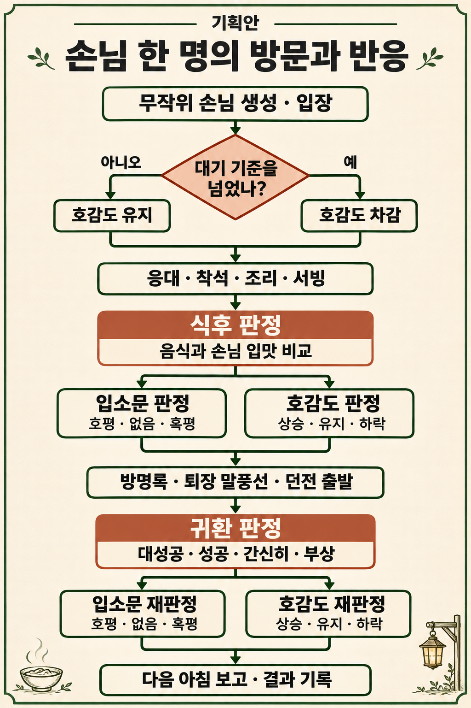

# 4-7. 귀환 보고와 재방문

[← 4장 목차](README.md) · [메인 기획서](../메인기획서.md)

전날 실제로 던전에 내려간 손님은 **다음 날 아침** 한 명씩 돌아와 보고한다. 1일차 본영업에는 전날 손님이 없으므로 보고가 없고, 2일차 아침부터 시작한다. 이 화면이 다음 처방의 단서가 된다.

## 보고에 나오는 것

| 항목 | 내용 |
| --- | --- |
| 결과 도장 | 대성공 · 성공 · 간신히 · 부상 (호감 표에서는 간신히 = 실패, 부상 = 대실패) |
| 한마디 | 「열기 따위는 문제도 아니었어」처럼 가장 모자랐던 축을 손님 말로 알려 준다 |
| 축별 결과 | 그 손님의 위험 축마다 「막아냈다」 또는 「N칸 모자랐다」. 돌발이 있었으면 돌발 줄 |
| 전리품 | 목적지 층의 일반 재료. 등급별 기본 3 / 2 / 1 / 0개. 💡 대성공이면 30%로 그 층의 희귀 재료 1개(기본 개수를 대신하는지 더하는지는 미정). 새 재료·새 레시피에는 「새」 표시 |
| 수첩 기록 | 그 층의 아직 모르던 위험을 최대 두 축까지 기록. 모자랐던 축을 먼저 기록한다 |
| 호감·단골 | 방문 호감 변화와 이유, 다음 사연까지 남은 수치, 레벨 업, 새 층 개방 |

돌려보낸 손님과 기다리다 떠난 손님은 던전에 가지 않았으므로 보고가 없다. 부상한 손님의 보고도 처리한다.

## 보고 뒤에 이어지는 것

| 무엇 | 언제 | 문서 |
| --- | --- | --- |
| 방문 호감 반영 | 보고에서 대기·입맛·탐험 점수를 보여 주고 한 번 반영 | [4-8](08-호감과입소문.md) |
| 단골 사연 해금 | 보고에서 호감이 9·21·36에 처음 닿으면 | [단골 사연 배정](단골사연배정.md) |
| 층 개방 | 가장 깊이 열린 층에 간 손님의 성공 이상이 두 번 쌓이면 | [4-9](09-성장과데모엔딩.md#층-개방) |
| 서사 장면 | 모든 보고와 필수 정산이 끝난 안전한 시점에, 후속 스토리 단계에서 | [4-10](10-후속스토리조건.md) |

같은 보고를 다시 열거나 되돌아가도 보상·호감·수첩 기록을 두 번 주지 않는다. 💡 서빙 때 그 방문의 결과를 기록하고, 다음 날 저장에 아직 처리하지 않은 보고를 담아 보고 처리 ID로 한 번만 적용하는 방식은 제안 단계다([현재 결정과 검토 사항](../08-결정필요사항/현재결정과검토사항.md#저장과-게임-진입)).

## 쉬는 손님과 재방문

- 부상한 손님은 이틀 동안 오지 않는다. 던전에 내려가 있는 동안에도 오지 않는다.
- 재방문한 손님은 같은 손님 식별자(guestId)와 이름·개인 취약점·취향을 유지하고 새 방문 식별자를 받는다. 대사는 새 목적지와 컨디션에 맞춰 다시 고른다. 이름 규칙은 [손님 이름과 재방문](../03-세계관과스토리/손님이름과재방문.md)에 있다.
- 재방문 응대에서는 이전 식사를 떠올리는 말로 취향을 암시한다(예: 「지난번 빵은 더 없소?」).
- 💡 이번 방문 점수를 더한 개인 호감이 0 미만이 되면 재방문을 거절하고, 다시 오지 않는 방향이다(송예찬 의견, 팀 의견 요청 중). 계산은 [4-8](08-호감과입소문.md#개인-호감과-재방문)에 있다.
- 🔴 전날 손님 중 누가 다음 영업의 재방문 후보가 되는지, 결석으로 빈 예정 자리를 새 손님으로 채울지는 정하지 않았다.

## 실패해도 게임은 이어진다

게임 오버는 원래 기획에 없다. 기본 재료 무한은 3D 웹빌드에서 자원이 바닥나 진행이 막혔던 문제를 해결한 규칙이다. 금화·양념이 없어도 무료 기본 요리로 영업을 이어 간다. 실패의 결과는 부상 휴식·전리품 감소·관계와 성장의 지연으로 전달한다.

## 첫 재방문 검증 (튜토리얼 이후)

처음 플레이한 사람이 방명록·아침 보고·재방문 대사를 보고 다음 접시에 남길 효과와 바꿀 맛을 자기 말로 설명하는지 확인한다. 🔴 보고 중 불러오기와 보상 중복 방지의 저장 범위는 후속 결정이다.

## 기획과 구현

- **기획**: 위 보고 항목과 보고 뒤 처리.
- **구현 (f7f286c 코드 기준, 실행 검증 아님)**: 서빙 때 등급과 전리품을 방문 결과에 한 번 기록하고, 다음 아침 보고를 확정하면 전리품을 재고에 더한다. 이미 확정한 보고는 다시 지급하지 않는다. 보고 도중에는 저장하지 않으며, 불러오면 일차 시작으로 돌아가 보고를 처음부터 다시 받는다(2026-11-24 송예찬 확인, PR #29). 💡 희귀 재료는 대성공 때 기본 전리품에 1개를 더하는 시험 구현이다([ReturnReportLog.cs](../../../Assets/_DOB/02.Scripts/System/ReturnReportLog.cs) · [VisitResultLog.cs](../../../Assets/_DOB/02.Scripts/System/VisitResultLog.cs) · [ExpeditionRewards.cs:4–5](../../../Assets/_DOB/02.Scripts/Define/ExpeditionRewards.cs)). 층 해금·호감 표시는 이 문서에서 확인하지 않았다. 귀환 화면 제작 참고(그림 7)는 [식후 반응과 귀환 보고 화면](../06-인터페이스/04-식후반응과귀환보고화면.md)에 있다.
