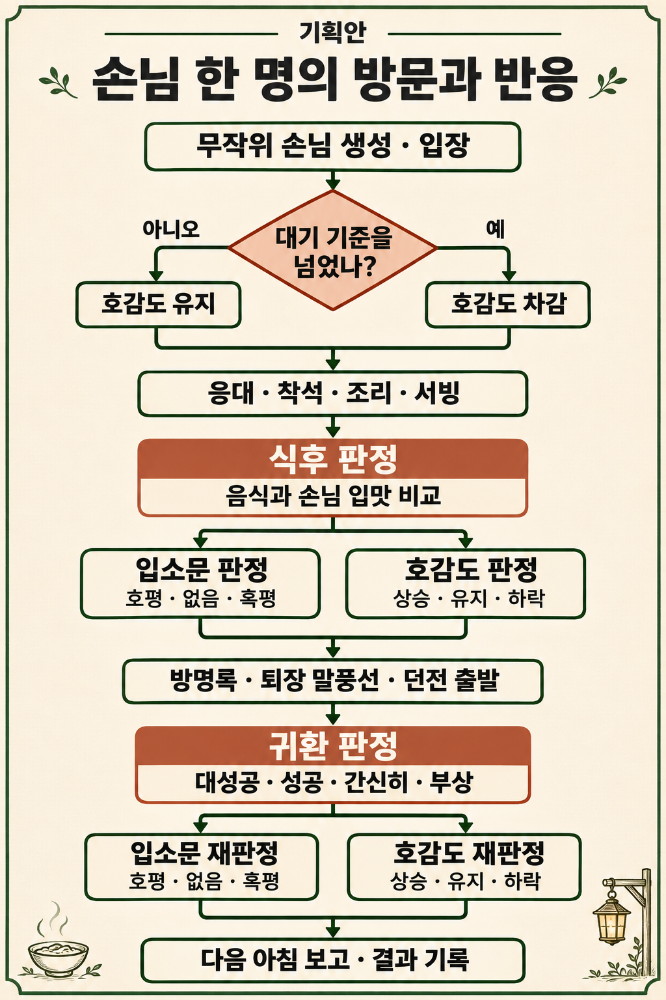

# 4-8. 호감과 입소문

[← 4장 목차](README.md) · [메인 기획서](../메인기획서.md)

기준: [FeatureManagerMap F10](../../개발/FeatureManagerMap.md#손님-한-명의-방문-호감-계산). 이 문서의 수치는 모두 💡 시험값이며 팀 합의 전이다.

손님의 방문 한 번은 **방문 점수** 하나를 만든다. 이 점수는 서로 다른 두 곳에 들어간다.

| 쓰이는 곳 | 무엇인가 | 누구의 값인가 |
| --- | --- | --- |
| 개인 호감 | 그 손님과의 관계. 단골·사연·재방문을 정한다 | 손님마다 따로 쌓인다 (guestId) |
| 입소문 | 가게 전체의 평판. 다음 영업의 손님 수를 정한다 | 전날 손님 전체의 합 |

「그 집에서 먹고 내려가면 살아 돌아온다」가 가장 강한 소문이 되도록, 같은 탐험 결과가 두 곳 모두에 들어간다.

## 방문 점수

### 서빙하고 던전에 보낸 손님

**방문 점수 = 대기 점수 + 입맛 점수 + 탐험 결과 점수** (최소 −4, 최대 +6)

| 항목 | 계산 | 값 |
| --- | --- | --- |
| 대기 | 총 대기 초 = 맞이 대기 초 + 음식 대기 초 대기 점수 = 2 − ⌊총 대기 초 ÷ 10⌋ (총 대기 30초 미만에서 서빙한 경우) | 0~9초 2점 · 10~19초 1점 · 20~29초 0점 |
| 입맛 | 손님 입맛 태그 두 개를 각각 채점. 맞으면 +1, 틀리면 −1 | −2 · 0 · +2 |
| 탐험 결과 | 귀환 등급 | 대성공 +2 · 성공 +1 · 실패(간신히) −1 · 대실패(부상) −2 |

- 대화·수첩·재료 선택 중에는 대기 시간이 멈춘다.
- 입맛 점수는 금화에 쓰는 맛 점수 0~4와 다른 값이다([4-6](06-주방과서빙.md#맛과-금화)).
- 기획상 이 점수는 다음 아침 귀환 보고에서 「기다림 +2 · 입맛 +2 · 대성공 +2」처럼 항목별 이유와 함께 보여 주고, 한 번만 반영한다.

### 서빙하지 못한 손님

| 경우 | 방문 점수 | 반영 |
| --- | --- | --- |
| 기다리다 떠남 | 총 대기 30초가 될 때까지 서빙받지 못하면 떠난다. **−4** (본영업, 방문당 한 번) | 🔴 반영 시점 미정 |
| 돌려보냄 | **−4** (본영업, 방문당 한 번) | 그날 일일 정산 |

두 경우 모두 대기·입맛·탐험 점수는 더하지 않는다. −4는 서빙한 방문의 최솟값(대기 0 + 입맛 −2 + 대실패 −2)과 같다. 0일차 연습의 처리는 [F14 연습안](../../개발/FeatureManagerMap.md#저장과-후속-제작--튜토리얼-사운드-스토리)이다.

### 같은 반응을 다시 열면

식후 반응이나 귀환 보고를 다시 열어도 기록된 결과를 그대로 보여 주고 다시 계산하지 않는다. 음식을 좋아했어도 귀환 결과에 따라 다른 반응이 나올 수 있다.

## 개인 호감과 재방문

| 규칙 | 값 |
| --- | --- |
| 누적 | 손님마다 방문 점수를 더한다. 표시 범위 0~36 |
| 반영 | 서빙한 손님은 귀환 결과가 나온 뒤 그 방문의 합계를 한 번 반영한다 |
| 재방문 거절 | 💡 이번 방문을 더한 값이 0 미만이면, 0으로 맞추기 전에 거절을 기록한다. 거절한 손님은 다시 오지 않는 방향이다(송예찬 의견, 팀 의견 요청 중) |
| 계산 예 | 5에서 −1 → 4 · 5에서 −2 → 3(재방문) · 1에서 −2 → −1(거절) · 5에서 돌려보냄(−4) → 1 |

### 예 · 처음 오는 손님 (누적 호감 0)

대기 0점이고 입맛 태그 두 개를 모두 놓쳐 입맛 −2를 받았다.

| 탐험 결과 | 방문 점수 | 누적 호감 | 다음 방문 |
| --- | --- | --- | --- |
| 대성공 | 0 − 2 + 2 = 0 | 0 | 방어가 맛 감점을 만회한다. 재방문 후보에 남는다 |
| 성공 | 0 − 2 + 1 = −1 | −1 → 거절 | 재방문을 거절한다 |
| 실패 | 0 − 2 − 1 = −3 | −3 → 거절 | 재방문을 거절한다 |
| 대실패·부상 | 0 − 2 − 2 = −4 | −4 → 거절 | 부상으로 쉬고 호감도 음수다. 예정 명단에서는 한 명만 뺀다 |

이미 호감이 쌓인 손님이라면 같은 −1을 받아도 기존 값에서 빼므로 거절되지 않을 수 있다(5 → 4).

### 누적 호감이 열어 주는 것

| 누적 호감 | 일어나는 일 |
| --- | --- |
| 9 | **단골 전환**. 이름은 그대로 두고 [단골] 태그가 붙는다. 같은 보고에서 첫 사연 조건을 평가한다 |
| 9 · 21 · 36 | 단골 사연이 한 단계씩 열린다 · 플레이어 스토리 해금 → [단골 사연 배정](단골사연배정.md) |
| 15 이상 | 70% 확률로 「이 재료를 가져올게」라고 약속한다. 성공하면 그 재료 +2 · 플레이어 스토리 해금 |
| 21 이상 | 대사 단서를 두 개 말해 준다 · 플레이어 스토리 해금 |
| 36 | 전리품 +1 (탐험 등급의 기본 전리품·희귀 재료·맛 보너스와 별개) |

기준을 9·21·36으로 둔 이유: 예전 기준(3·5·7·12)은 한 방문 최대 +1을 전제로 했다. 지금은 한 방문 최대 +6이므로 기준을 약 3배로 올려, 보통 방문(약 +3)으로 세 번쯤 와야 단골이 되는 속도를 유지한다. 세 손님일 때의 9점은 하루 최대의 50%에 해당하는 가게 기준점이기도 하다.

## 입소문 — 다음 영업의 손님 수

개인 누적 호감과 상관없이, 전날 방문 점수만으로 계산한다.

| 기호 | 뜻 |
| --- | --- |
| N | 전날 손님 수. 서빙한 손님과 대기 이탈자를 넣는다. 돌려보낸 손님을 넣을지는 🔴 답변 대기 |
| S | 전날 그 손님들의 방문 점수 합. 💡 개인 누적의 상·하한을 적용하기 전 점수를 쓴다(누적 36인 단골의 +6도 들어간다). 이탈자의 −4도 더한다 |
| 하루 최대 | 6N |

S가 하루 최대의 **60 · 75 · 85 · 100%**에 닿을 때마다(필요 점수는 올림) 다음 영업에 한 명씩 늘린다. 최대 +4명이다. **N이 0이면 추가도 0명**이다.

| 입소문 추가 | 전날 3명 · 최대 18점 | 전날 4명 · 최대 24점 |
| --- | --- | --- |
| +0명 · 60% 미만 | 10점 이하 | 14점 이하 |
| +1명 · 60% 이상 | 11~13점 | 15~17점 |
| +2명 · 75% 이상 | 14~15점 | 18~20점 |
| +3명 · 85% 이상 | 16~17점 | 21~23점 |
| +4명 · 100% | 18점 | 24점 |

85%와 100%는 세 명일 때 16점에 +3명, 만점 18점에 +4명이 되도록 고른 제안값이다.

**돌려보낸 손님을 N에 넣는다면** — +6 세 명과 돌려보낸 한 명: 빼면 18/18 → +4명, 넣으면 14/24 → +0명. 넣을 때는 N에 1명과 S에 −4를 함께 더한다.

### 실제로 오는 손님

**그날 예정 인원 = 성장 단계의 기본 손님 수 + 입소문 추가(0~4명)** — 1일차 본영업 기본은 3명이다. 기본 20명 단계라면 결석 반영 전 20~24명이다. 영업을 열 때 그날 최종 손님 수를 정한다.

예정 명단에서 ① 던전에서 다쳐 쉬는 손님, ② 개인 호감이 음수가 되어 거절한 손님을 뺀다. 두 사유가 겹쳐도 같은 손님은 한 번만 뺀다. 예정에 없던 손님은 빈자리를 만들지 않는다. 손님이 단서를 놓쳤어도 음식과 자리의 효과가 실제 위험을 덮었다면 부상 결석은 생기지 않는다.

**예** — 전날 네 손님의 방문 점수가 +6, +6, +2, −1이면 S = 13. 24점의 60%(15점)에 못 미쳐 추가 0명이다. 기본 3명 단계라면 3명이 예정된다. +2 손님(대기 +2, 입맛 +2, 대실패 −2)은 부상으로 쉬고, 처음 온 −1 손님(대기 0, 입맛 −2, 성공 +1)은 재방문을 거절한다. 두 사람이 모두 예정 명단에 있었다면 두 자리가 비고, 빈자리를 채우지 않는 안에서는 한 명이 온다.

## 언제 무엇이 정해지나 (기획)

| 시점 | 정해지는 것 |
| --- | --- |
| 서빙·식사 | 맛 소감·방명록. 대기·입맛 점수의 근거(기다린 시간·먹은 요리) |
| 그날 일일 정산 | 돌려보낸 방문의 −4 |
| 다음 아침 보고 | 탐험 결과와 항목별 방문 점수를 보여 주고 개인 호감에 한 번 반영. 호감이 9·21·36에 처음 닿으면 단골 전환·사연 해금([단골 사연 배정](단골사연배정.md#사연-해금)) |
| 다음 영업 시작 | 전날 S와 N으로 입소문 추가 인원, 결석을 뺀 그날 손님 수 |
| 저장 | 일차 시작 스냅샷. 미처리 보고를 다음 날 저장에 담는 방식은 💡 제안 → [4-7](07-귀환보고와재방문.md) |
| 정하지 않음 | 대기 이탈 −4의 반영 시점, 재료 약속·전리품 +1이 실제로 지급되는 시점 |

## 기획과 구현

- **기획**: 위 표. 서빙한 손님의 방문 점수는 다음 아침 보고에서 보여 주고 반영한다.
- **구현 (f7f286c 코드 기준, 실행 검증 아님)**: 서빙 때 대기 점수를 확정하고, **그날 마감 정산에서** 끝난 방문의 방문 점수와 다음 영업 추가 인원을 한 번 계산한다. 입맛 점수는 손님 입맛·요리 태그 데이터가 생길 때까지 💡 임시 0이다. 돌려보낸 손님은 N에 넣지 않는 설정이다. 개인 누적 호감·단골·사연은 아직 없다([RelationshipManager.cs:35·75](../../../Assets/_DOB/02.Scripts/Manager/RelationshipManager.cs) · [ServiceRoster.cs](../../../Assets/_DOB/02.Scripts/System/ServiceRoster.cs) · 수치는 `08.Data/SO_AffinityRules`). 정산 시점이 기획(다음 아침 보고)과 다르므로 팀 확인이 필요하다.

## 남은 결정 (🔴)

돌려보낸 손님을 N에 넣을지, 대기 이탈 −4를 언제 반영할지, 음수 호감 손님의 영구 미방문(💡 의견 요청 중), 결석 자리 보충, 성장 단계별 기본 인원 → [8장 결정 필요 사항](../08-결정필요사항/README.md)

예전 수치안(입맛 = 맛 점수 − 2, 간신히·부상 0점, 떠남·돌려보냄 −1, 기본 3명 + 입소문 점수 ÷ 2)은 [결정 변경 이력](../08-결정필요사항/결정변경이력.md)에 있다.
