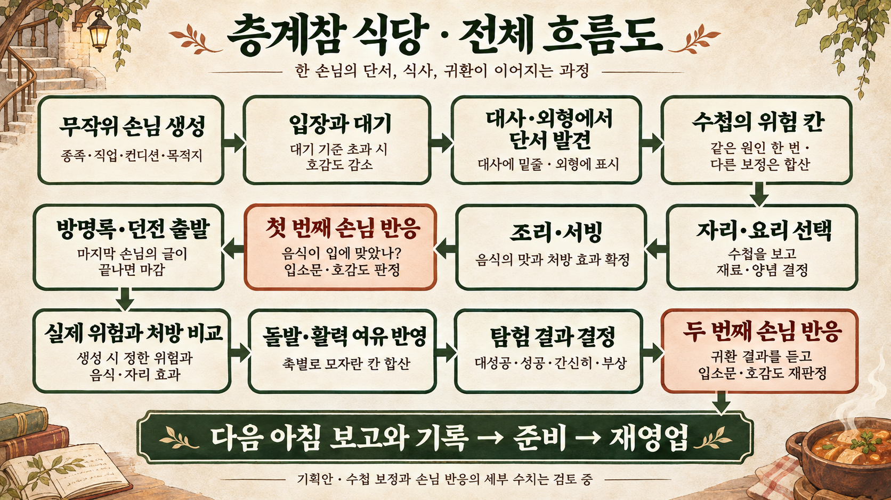

# 기획

「다녀왔어: 층계참 식당」의 기획 자료입니다. 기준은 [팀 노션 기획](https://app.notion.com/p/3fff7d6373c381a49d71e04d2750ef15)이며, Git에서는 **[메인 기획서](MainPlanning.md)** 에서 시작해 장별 폴더로 내려갑니다.
현행 영업·호감·입소문·데모 기준은 [구현 기능과 총괄 Manager 구성안 F10](../개발/FeatureManagerMap.md#손님-한-명의-방문-호감-계산), 결정 상태는 [최신 결정과 적용 기준](08-결정필요사항/CurrentDecisions.md)에서 확인합니다.

| 장 | 상세 문서 |
| --- | --- |
| [1. 게임 개요](01-게임개요/README.md) | — |
| [2. 타겟 사용자 분석](02-타겟사용자/README.md) | — |
| [3. 세계관 및 스토리](03-세계관과스토리/README.md) | [손님 이름 생성·유지](03-세계관과스토리/GuestNames.md) · [단골 사연 조각](03-세계관과스토리/RegularStoryFragments.md) · [스토리 B안과 사건 트리거](03-세계관과스토리/StoryBTriggers.md) · [엔딩 이후 영업 방식 후보](03-세계관과스토리/PostEndingOptions.md) |
| [4. 핵심 플레이 구조](04-핵심플레이/README.md) | [첫 플레이 범위와 완료 기준](04-핵심플레이/FirstPlayScope.md) · [방문 대사 생성기와 손님 수첩](04-핵심플레이/DialogueGenerator.md) · [첫날 손님 대사·단서 원고](04-핵심플레이/FirstGuestsScript.md) · [단골 사연 목록](04-핵심플레이/RegularStories.md) · [흐름도](04-핵심플레이/Flowcharts/) |
| [5. 데이터](05-데이터/README.md) | [첫 영업 판정 시험용 손님 3명](05-데이터/FirstGuestsData.md) · [조건별 대사·관찰 단서표 (CSV)](05-데이터/DialogueClueRules.csv) · [첫 플레이 레시피·재료·경제 검수](05-데이터/FirstPlayEconomy.md) |
| [6. 인터페이스 구성](06-인터페이스/README.md) | [첫 영업 연출안](06-인터페이스/FirstServiceDirection.md) |
| [7. 개발 전략](07-개발전략/README.md) | 🗄️ 웹 시제품 기록(보관): [V0.4 영업·조리](07-개발전략/웹시제품기록/PrototypeV04ServiceCooking.md) · [단골 호감·사연](07-개발전략/웹시제품기록/RegularRelationships.md) |
| [8. 결정 필요 사항](08-결정필요사항/README.md) | [최신 결정과 적용 기준](08-결정필요사항/CurrentDecisions.md) |
| [9. 2026-10-30 승인 반영·제작 기준](09-승인과제작기준/README.md) | — |
| [10. 노션 17장 선택 결정 반영](10-노션결정이력/README.md) | [팀 노션 반영 기록](10-노션결정이력/NotionUpdateDraft.md) |

## 흐름도

그림 원본은 [04-핵심플레이/Flowcharts](04-핵심플레이/Flowcharts/)에 있으며, 발표 사이트도 이 경로에서 가져갑니다. 첫 제작 범위는 **1일차 본영업 → 다음 날 아침 보고 → 준비 → 재영업 시작**이고, 0일차 튜토리얼은 그 뒤에 붙입니다.

| 궁금한 장면 | 자세히 볼 그림 |
| --- | --- |
| 언제 다음 손님을 받고 언제 영업을 마감하나요? | [① 첫 영업과 재영업](04-핵심플레이/Flowcharts/01-first-service.png) |
| 같은 말을 찾아도 왜 독 칸이 더 오르지 않나요? | [② 대사·외형 단서와 수첩 보정 제안](04-핵심플레이/Flowcharts/02-guest-clues.png) |
| 어떤 위험이 부족해서 이 귀환 등급이 나왔나요? | [③ 탐험 결과와 기본 전리품](04-핵심플레이/Flowcharts/03-expedition-result.png) |
| 오래 기다린 손님, 음식이 입에 맞은 손님, 던전에서 돌아온 손님은 어떻게 반응하나요? | [④ 대기·식후·귀환 반응 기획안](04-핵심플레이/Flowcharts/04-guest-reactions.png) |

## 노션 제작 카드

| 카드 | 검토 상태를 확인할 Git 문서 |
| --- | --- |
| [제작 01 첫 플레이 범위·완료 기준 확정](https://app.notion.com/p/40bf7d6373c3811faca5e3cd5270e818) | [첫 플레이 범위와 완료 기준](04-핵심플레이/FirstPlayScope.md) |
| [제작 02 첫 손님 3명·해법·시험 데이터](https://app.notion.com/p/40bf7d6373c381ff87e6fd61f6cc236a) | [첫 영업 판정 시험용 손님 3명](05-데이터/FirstGuestsData.md) |
| [제작 03 관찰 단서·주문·튜토리얼 대사](https://app.notion.com/p/40bf7d6373c3811ca8dcd1a772d1e803) | [첫날 손님 대사·단서 원고](04-핵심플레이/FirstGuestsScript.md) |
| [제작 04 레시피·재료·경제 데이터 입력 검수](https://app.notion.com/p/40bf7d6373c3810e9ebad8481324787e) | [첫 플레이 레시피·재료·경제 검수](05-데이터/FirstPlayEconomy.md) |
| [제작 05 귀환 보고·카엘 독백·회상 원고](https://app.notion.com/p/40bf7d6373c38194a32fd1263b1423ce) | [첫 영업 연출안](06-인터페이스/FirstServiceDirection.md) · [스토리 B안과 사건 트리거](03-세계관과스토리/StoryBTriggers.md) |

옛 `플레이/`·`시스템/`·`콘텐츠/`·`밸런스/` 폴더와 이동 안내는 없앴고, 모든 본문은 위 10개 장 폴더에 있습니다. 이전 경로의 문서는 Git 기록에서 찾습니다.
