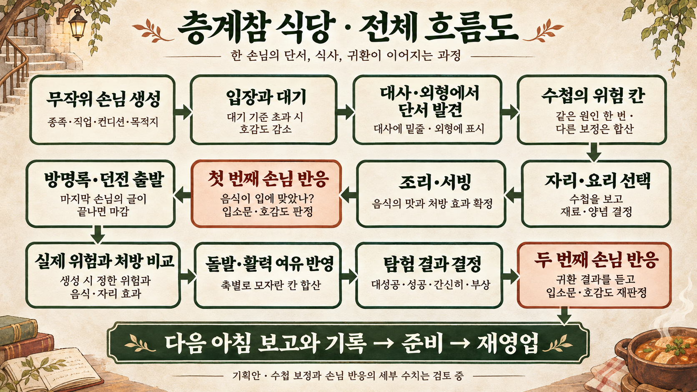

# 핵심 플레이·진행

**첫 영업 → 다음 날 아침 보고 → 준비 → 재영업 시작**이 첫 플레이의 범위입니다. 팀이 같은 구간을 검토할 수 있도록 단계별 흐름과 종료 지점을 함께 봅니다.

| 궁금한 장면 | 자세히 볼 그림 |
| --- | --- |
| 언제 다음 손님을 받고 언제 영업을 마감하나요? | [① 첫 영업과 재영업](Flowcharts/01-first-service.png) |
| 같은 말을 찾아도 왜 독 칸이 더 오르지 않나요? | [② 대사·외형 단서와 수첩 보정 제안](Flowcharts/02-guest-clues.png) |
| 어떤 위험이 부족해서 이 귀환 등급이 나왔나요? | [③ 탐험 결과와 기본 전리품](Flowcharts/03-expedition-result.png) |
| 오래 기다린 손님, 음식이 입에 맞은 손님, 던전에서 돌아온 손님은 어떻게 반응하나요? | [④ 대기·식후·귀환 반응 기획안](Flowcharts/04-guest-reactions.png) |

| 자료 | 확인할 내용 |
| --- | --- |
| [첫 플레이 범위와 완료 기준](FirstPlayScope.md) | 💡 첫날 손님 세 명, 단계별 흐름, 성공·예외 확인표, 담당별 전달 내용 |
| [엔딩 이후 영업 방식 후보](PostEndingOptions.md) | 귀환 후 영업 재개와 당시 검토한 운영 방식. 현재 선택은 [최신 결정](../CurrentDecisions.md)에 기록되어 있습니다. |

첫 플레이 범위의 검토 상태는 [노션 제작 01 카드](https://app.notion.com/p/40bf7d6373c3811faca5e3cd5270e818)에서 확인합니다.

[기획 목차](../README.md)
